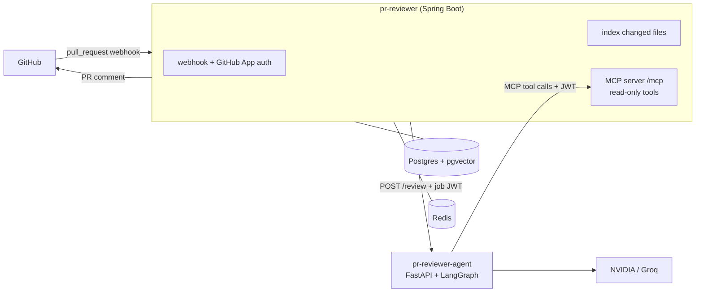

# PR Reviewer

A GitHub App that reviews pull requests automatically. A multi-agent service (`pr-reviewer-agent`) reviews the diff with specialist LLM agents and a critic that verifies each finding against the real source. This Spring Boot app handles everything around it: webhooks, GitHub App authentication, code indexing for RAG, and a read-only MCP server the agents use to read the repository.

## How it works



1. GitHub sends a `pull_request` event (`opened` or `synchronize`) to `POST /webhook/github`.
2. The app fetches the changed files, skips what it should not review, and indexes the files into pgvector (embeddings).
3. It mints a short-lived JWT for this one review and calls the agent service.
4. The agent reads the PR only through the MCP tools, reviews it, and returns structured findings and per-node stats.
5. The app formats the result (summary table, sections, confidence tiers) and posts it as a PR comment.

If the agent is disabled or fails, the app falls back to the original single-LLM pipeline (Groq), so a PR still gets a review.

## Security model

- The agent never holds GitHub credentials. It reads the repository only through the MCP server.
- Each review gets its own HS256 JWT, valid for 15 minutes, scoped to one repository, one PR and one commit (claims: `repo`, `pr`, `installation`, `sha`, `scope=mcp:read`).
- All MCP tools are read-only.
- Webhook requests are verified with the shared webhook secret (`X-Hub-Signature-256`).
- Secrets live in `.env` and `secrets/`, both outside git and outside the Docker images.

## MCP tools

Four read-only tools, for example `get_pr_diff`, `get_file_content` and `search_codebase` (semantic search over the indexed repository).

## Quick start

Full guide, including the GitHub App, the `.pem` key and ngrok: **[docs/SETUP.md](docs/SETUP.md)**.

```bash
git clone https://github.com/vidhanshu37/pr-reviewer
git clone https://github.com/vidhanshu37/pr-reviewer-agent   # next to pr-reviewer
cd pr-reviewer
# create .env (see docs/SETUP.md), add secrets/github-app.pem, then:
docker compose up --build
```

## Configuration

All settings come from environment variables (`.env`); the full table is in [docs/SETUP.md](docs/SETUP.md#5-configure). `agent.enabled` (`AGENT_ENABLED`) switches the agent pipeline on or off.

## Resilience

- Agent calls have a timeout (420 s) and a circuit-breaker/time-limiter guard; on failure the review falls back to the single-LLM pipeline.
- Indexing runs on every PR, independent of the agent.
- A `partial` agent result (a specialist failed) is posted as partial and never reported as a clean review.

## Tech stack

Java 21, Spring Boot 3.3, Spring AI (MCP server, pgvector store), PostgreSQL + pgvector, Redis, Resilience4j, Docker Compose. The agent service: Python, FastAPI, LangGraph, LangChain, uv.

## Repository layout

```
src/main/java/com/pr_reviewer/prreviewer/
  webhook/   webhook controller
  github/    GitHub App auth, API client
  review/    orchestration, review persistence
  agent/     agent client, comment formatter
  mcp/       MCP tools, job-token security
docs/SETUP.md   full setup guide
Dockerfile  docker-compose.yml
```

## Status and limitations

- Verified end to end on real pull requests (webhook → agent → PR comment) running in Docker on a laptop. Precision and recall have not been measured yet; an evaluation on real PRs is the next step.
- The manual review endpoint still uses the single-LLM pipeline only.
- Models make confident but wrong claims; the critic reduces these but does not remove them.
- Free-tier LLM providers have rate limits and their own terms, and the reviewed code is sent to the chosen provider.
- Local development setup (ngrok); no production deployment guide yet.

## Related

- Agent service: [pr-reviewer-agent](https://github.com/vidhanshu37/pr-reviewer-agent)
- Dashboard: separate repo, in progress.